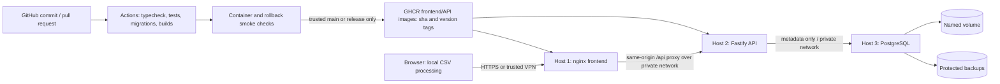

# ClearCSV — CSV quality workspace with a complete DevOps practical

ClearCSV parses, analyses and cleans CSV files **in the browser**. The original
preview, optional duplicate removal, median/mode filling, comparison and CSV
download remain intact. A new **Save run** control sends only summary counts,
a generated run ID and the frontend version to a small API. PostgreSQL stores
shared history; filenames, headers and CSV contents are never uploaded.

The smallest useful architecture here is React/Vite + Fastify + PostgreSQL.
There is no Kubernetes, queue, separate logging service or server-side CSV parser.

## Architecture



On one machine, Compose provides the same three service boundaries. The `migrate`
service is a short-lived command using the **same API image**, not a fourth image
or permanently running service. PostgreSQL uses its official pinned image.

## What was audited and preserved

- One pnpm lockfile, Node **24.x**, pnpm **11.25.0**. Actual frontend packages:
  React/React DOM 19.3.0, TypeScript 7.0.2, Vite 8.3.4, Papa Parse 5.7.0,
  Vitest 5.0.4, Playwright 1.64.0. Existing 32 CSV tests and the build passed before edits.
- Existing frontend components and `src/lib/processor.ts` were preserved.
- Existing frontend Docker/Actions/Vercel configuration was extended. The old
  pipeline did not publish images, deploy three hosts or test a database.
- Added Fastify 5.12.7, @fastify/cors 11.3.1, pg 8.23.1, node-pg-migrate 9.0.0.
  `package.json` and `pnpm-lock.yaml` are the source of truth for versions.
- Fixed the external-API CSP conflict for Vercel; Docker uses a same-origin proxy.
  The generated Word report under `output/` predates this enhancement.

## Quick start: complete application

Install Node24.x, pnpm11.25.0, Docker Engine with Compose v2.20+ (Docker Desktop
Linux engine on Windows), and Git. Docker needs enough memory for two Node builds.
Run from the repository root:

```powershell
pnpm install --frozen-lockfile
Copy-Item .env.example .env
node -e "const f=require('node:fs'),c=require('node:crypto');f.mkdirSync('secrets',{recursive:true,mode:0o700});f.chmodSync('secrets',0o700);f.writeFileSync('secrets/postgres_password',c.randomBytes(32).toString('hex'),{mode:0o444,flag:'wx'});f.chmodSync('secrets/postgres_password',0o444)"
docker compose build
docker compose up -d --wait --wait-timeout 180
pnpm test:containers
docker compose ps -a
```

On Linux/macOS use `cp .env.example .env` instead of `Copy-Item`. The other commands
are the same. The secret command **refuses to overwrite an existing password**;
run it only once. A protected parent directory prevents other host users from
reading the file; read-only file mode lets the nonroot API user read its mounted
Compose secret. Compose secrets here are file mounts, not an encrypted vault.
Never rotate the file alone on an existing database: change the database role's
password in a controlled administration session and update both API/DB copies.

Open **http://127.0.0.1:8080**. Load sample data → Clean data → **Save run** →
refresh the page. The history row shows **12 → 10 rows**, **6 → 0 missing**,
**2 → 0 duplicates**. Saving is optional; API failure never blocks CSV download.

Expected services: db/API/frontend `healthy`; migrate `Exited (0)`.
PostgreSQL has **no published host port**. Frontend/API host ports bind only to
127.0.0.1. If a port is busy, change `FRONTEND_PORT` or `API_PORT` in `.env`;
also update `CORS_ORIGIN` when changing the frontend's origin. On this machine
port3000 was occupied, so local verification used API13001 without stopping the
unrelated process. Default configuration still uses port3000.

```powershell
# Keep metadata volume on ordinary shutdown:
docker compose down
# Start again, without rebuilding:
docker compose up -d --wait --wait-timeout 180
# See runtime logs (request bodies/passwords are not logged):
docker compose logs --tail 50 api
```

Do not use `docker compose down --volumes` on a database whose data you need.

## Local frontend development / standalone Vercel

```powershell
pnpm dev
# http://127.0.0.1:5173
pnpm build
pnpm preview
# http://127.0.0.1:4173
```

Without API configuration the original standalone CSV workflow works and history
is disabled. Docker's entrypoint generates `/config.json` at startup, enabling
same-origin history and setting a visible version. `API_UPSTREAM=api:3000` tells
nginx where to proxy requests; on three hosts use the API's private hostname:port.
No environment-specific address is baked into the Docker frontend image.

For Vercel set `VITE_API_URL` to your HTTPS API origin (no trailing `/api`), and
optionally `VITE_APP_VERSION`, then rebuild/redeploy. Set API `CORS_ORIGIN` to the
exact frontend origin. Build-time values override `/config.json`. Vercel still
hosts only the frontend; it cannot run the long-lived API/PostgreSQL containers.
Its CSP allows self plus HTTPS connections for this configurable API; Docker's
CSP restricts browser connections to self. Put remote history behind trusted
access/TLS and configure a real HTTPS backend before enabling it on Vercel.
No deployed Vercel settings or existing production site were changed in this task.

## Configuration

`.env.example` contains only nonsecret defaults/placeholders. `.env`, secret
files, backups, demo state and `deploy/*.env` are ignored by Git and excluded from
Docker build contexts. Never put real credentials into examples or Dockerfiles.

| Setting | Purpose |
| --- | --- |
| `FRONTEND_PORT`, `API_PORT` | Local host ports, loopback only |
| `API_UPSTREAM` | Container/private backend hostname:port, without scheme |
| `APP_VERSION` | Runtime version shown in UI and API readiness |
| `VERSION`, `FRONTEND_IMAGE`, `API_IMAGE` | Local Compose image repository/tag |
| `PGHOST`, `PGPORT`, `PGDATABASE`, `PGUSER` | API database connection settings |
| `PGPASSWORD_FILE` | API password-file path; Compose sets it to `/run/secrets/db_password` |
| `POSTGRES_PASSWORD_FILE` | Host path to the shared Compose secret file |
| `PGPASSWORD` | Alternative for local tooling only; do not set alongside password file |
| `PGSSLMODE` | `disable` for trusted local/VPN transport; `verify-full` for configured DB TLS |
| `PGSSLROOTCERT` | Trusted CA file for verified PostgreSQL TLS |
| `CORS_ORIGIN` | One exact allowed browser origin; CORS is not authentication |
| `VITE_API_URL`, `VITE_APP_VERSION` | Optional frontend build configuration for Vercel |

There are no accounts in this practical. Metadata is shared among trusted users.
Protect the frontend with gateway authentication or VPN for remote use. Do not
expose the API/database as unrestricted public services. Request size is limited,
unknown fields are rejected, row/count limits are enforced, and queries are
parameterized. History GET defaults to20 entries, maximum100 via `?limit=100`.

## API and reliability

| Endpoint | Result |
| --- | --- |
| `GET /health` | `{status:"ok",version:...}` when DB/schema ready;503 otherwise |
| `GET /api/runs?limit=20` | `{runs:[...]}` newest first, bounded history |
| `POST /api/runs` |201 for a new summary,200 for identical UUID retry,409 for conflicting retry |

POST fields are `id` (UUID), `inputRows`, `outputRows`, `missingBefore`,
`missingAfter`, `duplicatesBefore`, `duplicatesAfter`, `appVersion`. The server
sets `createdAt`. Other fields, including CSV contents, are rejected (400).
Malformed JSON, oversized requests and unsupported media types return meaningful
400/413/415 responses. DB failures return503 without exposing driver details.
Filling without deduplication can create duplicates, so the API deliberately allows
`duplicatesAfter` to exceed `duplicatesBefore` while enforcing row bounds.

The API waits for database/schema readiness with bounded retry on startup;
Compose also waits for PostgreSQL health and a successful migration command.
It reconnects after later failures, logs route/method/status/duration to stdout,
and handles SIGTERM/SIGINT with a bounded graceful shutdown. Logs omit request
bodies, identifying metadata, SQL and connection credentials.

```powershell
curl.exe --fail http://127.0.0.1:8080/health
curl.exe --fail http://127.0.0.1:8080/api-health
curl.exe --fail http://127.0.0.1:8080/api/runs
# Linux/macOS: use curl instead of curl.exe.
```

## Migrations, schema inspection and safe recovery

`node-pg-migrate` is a real migration tool with explicit reviewed SQL up/down
sections. It is smaller than adding an ORM for one metadata table. Files:

1. `migrations/1761955200000_create-processing-runs.sql` creates the constrained
   table/index. It does not include app_version.
2. `migrations/1761955201000_add-app-version.sql` adds the compatible, nonnull
   version column with default `unknown` for earlier rows.

`pgmigrations` records applied migrations; applying up again is a no-op. Migrations
are serialized by the tool's database lock and run transactionally. Never edit an
already released migration: add a new reviewed migration instead.

```powershell
# Controlled one-off command; uses the API image and Docker secret:
docker compose run --rm migrate
# Inspect actual schema and applied migrations:
docker compose exec db psql -U clearcsv -d clearcsv -c '\d processing_runs'
docker compose exec db psql -U clearcsv -d clearcsv -c 'TABLE pgmigrations;'
# Non-container tooling, only after setting PG* securely for that database:
pnpm build:api
pnpm db:migrate up
```

For the **entire clean-db + first migration + row + second migration + down/up +
backup recovery demonstration**, use:

```powershell
node scripts/devops-demo.mjs
```

It creates separate disposable databases for schema reversal and restoration.
It proves that dropping the version column preserves row counts but loses its
version values; reapplying up restores the column with `unknown`, and restoring
the pre-down backup into a fresh database restores the original version values.
Neither down nor restore targets the running application's metadata database.

The guarded low-level down command is **only for an explicitly disposable DB**:

```powershell
# Set PGDATABASE to your disposable test DB first, never production.
$env:ALLOW_DB_ROLLBACK='disposable'
pnpm db:migrate down 1
Remove-Item Env:ALLOW_DB_ROLLBACK
pnpm db:migrate up
```

Bash equivalent: `ALLOW_DB_ROLLBACK=disposable pnpm db:migrate down 1`.
Down without the guard or without exactly one step is refused. The guard is an
operator acknowledgement, not a detector of whether your database is important.
The first migration's down drops the table. Prefer forward fixes and retain
additive schema when rolling back applications; back up before any DB change.

## Backup and restore

A named volume is persistence, **not a backup**. The executable demo checks both
container recreation and a real `pg_dump`/restore, independently.

For an operator-managed local backup, capture bytes without PowerShell's older
text-redirection encoding conversions:

```powershell
New-Item -ItemType Directory -Force backups
node -e "const f=require('node:fs'),c=require('node:child_process');f.writeFileSync('backups/clearcsv.sql',c.execFileSync('docker',['compose','exec','-T','db','pg_dump','-U','clearcsv','-d','clearcsv','--no-owner','--no-privileges']))"
# Restore into a NEW disposable database, not over the running database:
docker compose exec db createdb -U clearcsv clearcsv_restore_test
node -e "const f=require('node:fs'),c=require('node:child_process');c.execFileSync('docker',['compose','exec','-T','db','psql','-U','clearcsv','-d','clearcsv_restore_test','-v','ON_ERROR_STOP=1','--single-transaction'],{input:f.readFileSync('backups/clearcsv.sql'),stdio:['pipe','inherit','inherit']})"
docker compose exec db psql -U clearcsv -d clearcsv_restore_test -c 'SELECT id,input_rows,output_rows FROM processing_runs;'
```

Restrict access to backups and copy them off the database host. For an actual
recovery, pause writes, restore to a new verified database, compare row IDs/counts,
then deliberately point the API to the recovered DB. Preserve the old DB until
recovery is accepted. Do not blindly overwrite an important database or volume.

## Tests: exact commands

```powershell
pnpm check
# Typechecks, frontend unit tests, API validation/outage tests, both builds.
pnpm test:db
# Creates a password-protected, random-name PostgreSQL container on a random
# loopback port; runs real migration/API/DB tests; removes only that container.
pnpm exec playwright install chromium
pnpm test:e2e
# Static/browser fallback tests; live API cases explicitly skipped here.
pnpm test:containers
# Requires full Compose app; override API_URL if you changed API_PORT.
$env:HISTORY_E2E='true'
$env:E2E_BASE_URL='http://127.0.0.1:8080'
pnpm test:e2e
Remove-Item Env:HISTORY_E2E,Env:E2E_BASE_URL
node scripts/devops-demo.mjs
# Isolated staging; leaves release1 running at http://127.0.0.1:18080.
node scripts/devops-demo.mjs cleanup
# Removes ONLY the fixed disposable project and its volume.
```

Individual commands: `pnpm typecheck`, `pnpm test`, `pnpm test:api`,
`pnpm build`, `pnpm build:api`. If you already have a disposable PostgreSQL DB,
set PG* and `PGDATABASE=..._test`, then run `pnpm test:integration`. These tests
use randomly named schemas and remove only those schemas. The `_test` name guard
helps prevent accidental use against important databases.

Linux full-stack browser command:
`HISTORY_E2E=true E2E_BASE_URL=http://127.0.0.1:8080 pnpm test:e2e`.
Deployment JSON checks: `python3 -m unittest discover -s deploy -p 'test_*.py'`.
Deployment flow checks: `bash deploy/test-remote.sh` (uses fake Docker/curl
to exercise failure/rollback state, **not** evidence of remote deployment).

## CI/CD and GHCR

The existing `.github/workflows/ci.yml` now:

1. Checks out, installs the pnpm lockfile and typechecks.
2. Runs frontend/API tests and real integration tests against temporary PostgreSQL.
3. Builds both apps and runs static browser checks.
4. Applies migrations to a clean database, starts the real API and tests browser history.
5. Builds both images, runs full Compose smoke, then the isolated persistence,
   outage/backup/release/rollback/migration demonstration.
6. Publishes **only after verify passes**, on main pushes or valid version tags.
   Pull requests have read-only repository permission; no registry write/deploy secrets.
7. Deploys only with manual dispatch on main, `deploy=true`, `DEPLOY_ENABLED=true`,
   configured production environment and required secrets. It checks all three
   roles and fails on migration/HTTP/version failure. No automatic DB down.

Actions are pinned to full resolved commit SHAs. PostgreSQL trust authentication
in the CI service is **only for disposable job-local test data**, bound to loopback;
the real Compose/deployed database uses a password-file secret.

GHCR image names for this repository:
`ghcr.io/27athsp/lab-ca-devops-frontend:sha-<40-char-commit>` and
`ghcr.io/27athsp/lab-ca-devops-api:sha-<40-char-commit>`, plus matching `vX.Y.Z`
release aliases. Never rely on latest. Existing SHA/release tags are not overwritten.
A release tag must match package.json and refer to main's history. Publish uses
job-scoped `GITHUB_TOKEN` with `packages:write`, not a committed PAT. Enable Actions,
allow the workflow's package permission, and grant the repository package access.
Private packages need a `read:packages` token on deployment hosts; a protected
credential helper is preferable to leaving tokens in plain Docker config.

Manual image commands (Bash; configure values for your own repository):

```bash
COMMIT=$(git rev-parse HEAD)
VERSION="sha-$COMMIT"
REGISTRY=ghcr.io/27athsp/lab-ca-devops
bash deploy/registry-login.sh YOUR_GITHUB_USERNAME /protected/ghcr-token
# Build each app separately; PostgreSQL is the official image, not a custom build:
docker build --build-arg "APP_VERSION=$VERSION" -t "$REGISTRY-frontend:$VERSION" .
docker build -f api/Dockerfile --build-arg "APP_VERSION=$VERSION" -t "$REGISTRY-api:$VERSION" .
docker push "$REGISTRY-frontend:$VERSION"
docker push "$REGISTRY-api:$VERSION"
docker pull "$REGISTRY-frontend:$VERSION"
docker pull "$REGISTRY-api:$VERSION"
docker pull postgres:17.6-alpine
# Only tag/push a release after checks pass; do not overwrite an existing tag:
docker tag "$REGISTRY-frontend:$VERSION" "$REGISTRY-frontend:v1.0.0"
docker tag "$REGISTRY-api:$VERSION" "$REGISTRY-api:v1.0.0"
docker push "$REGISTRY-frontend:v1.0.0"
docker push "$REGISTRY-api:v1.0.0"
```

These are operator commands; **nothing was pushed or published during this task**.
Publish the local code yourself when ready. A new green workflow run and successful
GHCR upload cannot be claimed from local verification alone.

For remote deployment create a GitHub **production** environment with required
reviewers as appropriate. Repository variables: `DEPLOY_ENABLED=true`,
`DEPLOY_PATH` (absolute checkout path, same on each host), and optionally
`DEPLOY_ENV_DIR` (protected role-env directory, defaults to `/etc/clearcsv`). Secrets: `DEPLOY_SSH_KEY`,
`DEPLOY_KNOWN_HOSTS` (pinned keys verified out of band), `DEPLOY_USER`,
`DEPLOY_PORT` (optional22), `DEPLOY_FRONTEND_HOST`, `DEPLOY_API_HOST`,
`DEPLOY_DB_HOST`. Preconfigure protected `frontend.env`, `api.env`, `database.env` files in
`DEPLOY_ENV_DIR`; prepare the external
DB volume, networking, registry read login and repository scripts on each host.
Select an already published `image_version` during workflow dispatch.
The workflow explicitly migrates the selected API release before starting it.

## Three hosts, application rollback, and the college demo

Follow [docs/THREE_HOST_DEPLOYMENT.md](docs/THREE_HOST_DEPLOYMENT.md) for exact
host setup, environment files, firewall/VPN/TLS requirements, registry login,
controlled migrations, health verification and explicit image rollback.

The executable interface, run on the corresponding Linux host, is:

```bash
bash deploy/remote-deploy.sh database /etc/clearcsv/database.env up
bash deploy/remote-deploy.sh api /etc/clearcsv/api.env migrate up
bash deploy/remote-deploy.sh api /etc/clearcsv/api.env up
bash deploy/remote-deploy.sh frontend /etc/clearcsv/frontend.env up
# For application rollback, first configure BOTH role envs with known-good
# explicit image tags and matching APP_VERSION. Keep the current DB schema:
bash deploy/remote-deploy.sh api /etc/clearcsv/api-known-good.env rollback
bash deploy/remote-deploy.sh frontend /etc/clearcsv/frontend-known-good.env rollback
```

The script records last/previous verified image and version; a failed health
check does not overwrite known-good state. It reports failure for an operator to
resolve; it does not silently claim automatic recovery.

| Operation | What actually changes |
| --- | --- |
| Restart a container | Same image/config; may clear transient process state |
| Revert a Git commit | Source history; running containers remain unchanged until rebuilt/deployed |
| Redeploy an old image | Running app version changes; persistent database stays |
| Reverse a migration | Schema/data may change or be lost; separately reviewed/recovered |
| Restore a backup | Recovers data/schema at backup time; newer writes need a recovery plan |

[docs/DEVOPS_DEMO.md](docs/DEVOPS_DEMO.md) contains the 10–15 minute order,
expected outputs and viva answers. The staging script proves release1 → release2
(visible version change) → controlled bad release → release1 rollback, preserving
both run records. It also proves DB recovery separately in disposable databases.

## Important files

```text
src/lib/processor.ts             Existing browser-only CSV processing (preserved)
src/lib/history.ts               Runtime config, counts-only API client and UUIDs
src/components/RunHistory.tsx    Optional save/retry/refresh history UI
api/app.ts                      Validated HTTP routes and safe errors/logging
api/database.ts                 Pool, password-file and TLS settings
api/server.ts                   Readiness retry and graceful shutdown
api/migrate.ts                  Guarded real migration runner
migrations/*.sql                Two version-controlled up/down migrations
tests/, api/tests/              CSV, API, migration, DB and browser checks
Dockerfile, api/Dockerfile       Two pinned multi-stage app images
nginx.conf, docker/             Frontend proxy/runtime configuration
compose.yaml                    Local three-tier app, one-shot migrations, volume
scripts/integration-test.mjs     Disposable real PostgreSQL tests
scripts/container-smoke.mjs      Real container HTTP/storage checks
scripts/devops-demo.mjs          Isolated release, persistence and recovery demo
deploy/                         Three-host manifests, scripts and verification tests
.github/workflows/ci.yml         Verification, gated publishing/manual deployment
vercel.json                     Standalone frontend hosting and HTTPS API CSP
```

## Troubleshooting and evidence

- Docker unavailable: start Docker Desktop, select Linux engine, wait for readiness.
- Secret denied on Linux: protect its parent directory0700 and make its bind-mounted
  read-only file readable by API UID1000 (e.g.0444 inside that protected parent).
- API unready: inspect DB health, migration exit status, host reachability, password
  file and matching role/database names. Never log or paste credentials.
- UI works but history fails: check `/api-health`, `/config.json`, exact CORS origin,
  HTTPS mixed-content rules and nginx API_UPSTREAM. Refresh history after recovery.
- Changed DB password file with old volume: PostgreSQL initialization does not rerun
  for existing data. Restore the original file or deliberately rotate the DB role.
- Migration fails: do not delete the volume; inspect reviewed SQL/state and permissions,
  restore into a separate DB or apply a forward fix after a backup.
- Demo already exists: inspect its evidence, then run `node scripts/devops-demo.mjs cleanup`
  before a new clean demonstration. This cleanup never targets the normal stack.

See [docs/VERIFICATION.md](docs/VERIFICATION.md) for actual local outcomes and the
precise limits: registry publishing, the new remote workflow and three real hosts
require external infrastructure and have not been executed from this session.
