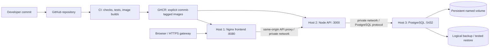

# ClearCSV DevOps demonstration and viva guide

This is a 10–15 minute presentation of the current frontend/API/PostgreSQL
implementation. Run the disposable local demonstrations before the presentation
so image downloads and builds do not consume the viva time. The local demo uses
the isolated Compose project `clearcsv-disposable-demo`, its own volume and ignored
`.devops-demo/` configuration/secrets. Do not point it at a real database or reuse
production environment files. A passing local demo is evidence for that local
environment; it does not prove that three remote hosts were deployed.

## Architecture to explain in the first minute



Say: “The browser parses CSV locally. Shared history stores a summary, not CSV
rows or filenames. Nginx serves the frontend and forwards API requests to the
second host. The API validates requests and writes metadata into PostgreSQL on
the third host. CI builds tagged application images; deployment replaces
containers while the database volume remains.”

The one-machine Compose environment demonstrates the same service boundaries
locally. Three-host operation uses the separate manifests and explicit host
configuration in [THREE_HOST_DEPLOYMENT.md](THREE_HOST_DEPLOYMENT.md).

## Before presenting

Use Node 24, pnpm and a working Docker Engine with Compose. From a Bash terminal
in the repository:

```bash
pnpm install --frozen-lockfile
pnpm check
pnpm test:e2e
node scripts/devops-demo.mjs
FRONTEND_URL=http://127.0.0.1:18080 API_URL=http://127.0.0.1:13000 APP_VERSION=1.0.0-demo.1 pnpm test:containers
```

`pnpm check` runs type checks, frontend/API tests and both builds.
`pnpm test:containers` checks the real container boundaries against the running
demo; the explicit addresses/version match the release left by the demo script.
The `node scripts/devops-demo.mjs` command
runs every isolated scenario in sequence: non-root containers, persistence,
backup/restore, database outage/recovery, release/rollback and reversible
migrations. It leaves release 1 running at `http://127.0.0.1:18080` and writes
`.devops-demo/results.json`, including verified checks and the two recorded IDs.
API host port is `13000`. The script explicitly records that remote deployment
and registry publishing were not tested. Record actual output from your run. Do not replace
failures with expected output or claim that a command ran when it did not.

The only optional command is cleanup:

```bash
node scripts/devops-demo.mjs cleanup
```

Cleanup removes this fixed project's disposable containers and volume. It does
not delete unrelated projects or the ignored local backup/evidence files. A fresh
full run refuses an existing demo project, so clean up after a rehearsal before
running the complete demonstration again. There are no individual phase flags.

Keep your published image references, successful CI run, deployment logs and
screenshots available. Remove tokens, credentials and sensitive host details
from any evidence shown to the examiner. The updated Word report in `output/` covers these API/database enhancements;
use its verified evidence with the current code and this guide.

## Timed presentation

| Time | Demonstration | Point to explain |
| --- | --- | --- |
| 0:00–1:30 | Architecture diagram and service responsibilities | Separate UI, application logic and persistence |
| 1:30–3:00 | Open ClearCSV, load a sample CSV, inspect validation/results and shared history | Local CSV processing; history contains only opted-in metadata |
| 3:00–5:00 | Show the full demo run's persistence and outage/recovery assertions | A recorded history ID survives database container replacement; API reports 503 during outage |
| 5:00–7:00 | Show backup/restore assertions and protected backup artifact | Backup alone is insufficient; restore must recover the recorded data |
| 7:00–9:30 | Show release 1 → release 2 → controlled failure → release 1 output and runtime version | Release identity changes, failed readiness is detected, explicit rollback restores a known release |
| 9:30–11:00 | Show the separate disposable database's migration assertions | Reviewed SQL has an up/down path; destructive down runs only on a disposable database |
| 11:00–13:00 | CI workflow, image tags and three-host deployment commands | Reproducible artifact promotion, private networking and controlled migrations |
| 13:00–15:00 | Questions and evidence | Distinguish local results from remote results and planned operations |

Run `node scripts/devops-demo.mjs` once for the full live demonstration, or show
its previously captured successful output alongside the resulting staging UI and
`results.json`. The stages run automatically; do not imply the script supports
pausing or selecting a phase. Use actual output to identify the versions and IDs.

## What to show for each claim

**Persistence:** record a history entry's ID before database container replacement,
then retrieve the same ID afterward. Explain that replacing the PostgreSQL
container reuses a named volume. A volume surviving replacement is not a backup.
Also show that stopping PostgreSQL produces API HTTP 503 while Nginx stays
available, and that the API reconnects after PostgreSQL returns.

**Backup and restore:** show creation of a logical PostgreSQL backup, restoration
into the demo's separate `clearcsv_restore_test` database, and a query assertion
confirming the recorded history ID/metadata. A file existing on disk does not
prove recoverability. Protect backups because they contain shared metadata.

**Release and rollback:** show release 1's runtime version, replace it with release
2, and show release 2's version. Show that an intentionally bad release fails
verification and is reported as a failure. Reapply release 1 explicitly, verify
its runtime version, and retrieve the same database record. App image rollback
does not undo SQL or restore lost data.

**Migrations:** show the migration files and the migration runner's separate
command. In `clearcsv_migration_test`, the script applies the first migration,
inserts a row, then adds the version column with the second migration. It backs
up the database, reverses one migration, verifies that core row metadata remains,
and reapplies the migration. The dropped version value returns as `unknown`;
restoring the pre-down backup into `clearcsv_recovered_test` recovers the original
version value. This demonstrates why reversible schema is not equivalent to data
recovery. The
guard `ALLOW_DB_ROLLBACK=disposable` is deliberate: a down migration can remove
data or make the API unready. Production rollback relies on compatible schema
changes and a tested recovery plan.

**CI/CD:** show checks finishing successfully before image publication. Identify
the image's explicit commit/version tag and the runtime version returned by
`/config.json` and `/api-health`. Publishing an image does not itself deploy it;
the host deployment step must pull, start and verify that exact release.

## Commands for an actual three-host demonstration

These commands execute independently on the designated Linux machines after
the private network, firewall, credentials, image registry and env files have
been configured. They do not perform remote execution themselves.

```bash
# Database host, one-time external volume creation followed by startup.
docker volume create clearcsv-postgres-data
bash deploy/remote-deploy.sh database /etc/clearcsv/database.env up

# API host, reviewed schema step followed by the image deployment.
bash deploy/remote-deploy.sh api /etc/clearcsv/api.env migrate up
bash deploy/remote-deploy.sh api /etc/clearcsv/api.env up

# Frontend host, after the matching API release is healthy.
bash deploy/remote-deploy.sh frontend /etc/clearcsv/frontend.env up
```

For release rollback, use env files containing the previous explicit image tag
and matching `APP_VERSION`, keeping database and secret settings unchanged:

```bash
# API host, then frontend host.
bash deploy/remote-deploy.sh api /etc/clearcsv/api-release-a.env rollback
bash deploy/remote-deploy.sh frontend /etc/clearcsv/frontend-release-a.env rollback
```

Run commands only against hosts you are authorized to administer. A deployment
failure exits nonzero and retains the last verified image reference locally;
it does not silently reverse migrations. For prerequisites, secret-file
permissions, registry login and firewall rules, follow the full deployment guide.

## Short viva answers

| Question | Answer |
| --- | --- |
| Why three services? | They separate browser presentation, server validation and durable storage, so each can be built/replaced independently. |
| Why is the CSV not uploaded? | Processing stays in the browser. Shared history needs only summary metadata, which reduces unnecessary data transfer and exposure. |
| Why a database volume? | A container's writable layer is disposable. The named volume keeps PostgreSQL data when the container is recreated. |
| Is a volume a backup? | No. Deletion, corruption or host failure can affect it; an independent backup with a tested restore provides recovery. |
| Why explicit image tags? | They identify the artifact being deployed and allow a reviewed previous release to be reapplied. Release tags must not be moved. |
| What is readiness? | The API must reach PostgreSQL and find its required schema. HTTP 200 alone is insufficient if the response identifies the wrong release. |
| Why are migrations separate? | Schema changes need controlled execution and failure reporting rather than running on every server boot. |
| Why not run down on every rollback? | An older image may work with the newer schema, while down SQL can remove data. Compatibility and recovery are separate decisions. |
| Does CORS secure the API? | No. It restricts browser cross-origin behavior; trusted access, network restrictions and gateway authentication provide the deployment boundary here. |
| Why proxy API requests through Nginx? | The browser uses one origin, while Nginx reaches the private API hostname from the frontend host. |
| Does green CI prove deployment succeeded? | No. CI checks the artifact; the selected host must also pull, run and verify the intended version. |
| What evidence should be submitted? | Actual passing command output, relevant screenshots, tagged image references, CI run and host verification logs, with secrets removed. |

## Evidence log to fill after running

| Evidence | Actual result / reference |
| --- | --- |
| Frontend/API checks and build | Record command, date and exit status |
| Browser and container checks | Record command, date and exit status |
| Persistence entry ID before/after | Record the same ID and relevant assertion output |
| Backup/restore verification | Record the restored ID/count and assertion output |
| Release 1 → release 2 → failed release → rollback | Record actual versions and verification results |
| Disposable migration down/up | Record the runner output and final readiness |
| GHCR and CI | Record exact image references and CI run link |
| Three remote hosts, if exercised | Record host roles, redacted commands and actual health/version checks |

Leave entries pending when they have not been executed. Keep local evidence and
remote evidence clearly labeled.


## Verified publication at delivery

Code commit `da2caaa24b447cc5166af4e61a3d7b0cd84afcf5` passed
[GitHub Actions run 41336945319](https://github.com/27Athsp/LAB-CA-DEVOPS/actions/runs/41336945319).
The verify and publish jobs both succeeded; deploy was correctly skipped by the
manual gate. The remote run checked 37 frontend/helper cases, 19 API cases, 5 real
PostgreSQL cases, 4 deployment verifier cases, 12 static and 2 live browser cases,
container smoke and all 9 staging demonstration groups. Both app images were
published with `sha-da2caaa24b447cc5166af4e61a3d7b0cd84afcf5` tags. Show this run
and `CI_EVIDENCE.json` for registry evidence. Three remote hosts remain unverified.
